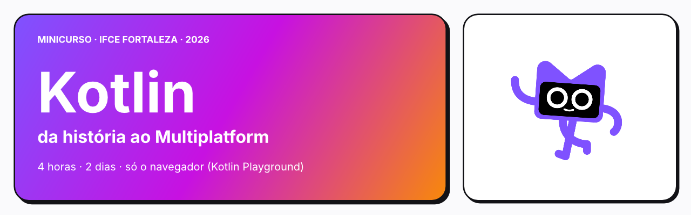
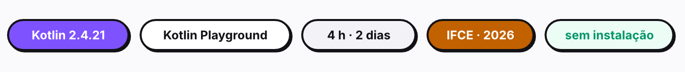
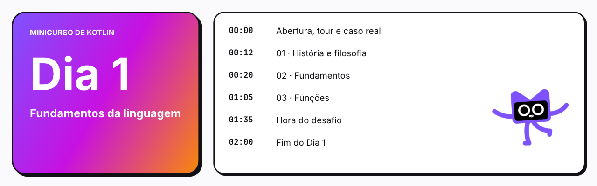
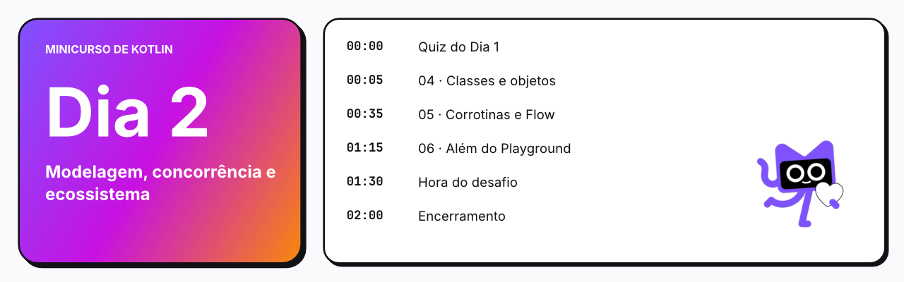
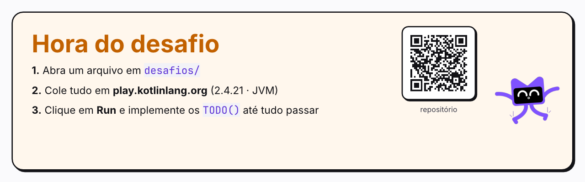

  

  

# Minicurso de Kotlin · IFCE 2026

Material do minicurso de Kotlin para a turma de **Engenharia de Computação do IFCE, Campus Fortaleza**: slides, código de todos os exemplos e desafios com correção automática.

**Você só precisa do navegador.** Tudo roda no [Kotlin Playground](https://play.kotlinlang.org/).

| | |
|---|---|
| 📅 Formato | 4 horas, em 2 encontros de 2 horas |
| 🧑‍🏫 Ministrante | Robson Freitas Ribeiro · Senior Software Engineer na CI&T · [GitHub](https://github.com/robsonribeiroft) · [LinkedIn](https://www.linkedin.com/in/robsonribeiroft/) |
| 📄 Ementa | [EMENTA.md](EMENTA.md) |
| 🖥️ Slides (PDF) | [Dia 1](deck/Minicurso_Kotlin_Dia1.pdf) · [Dia 2](deck/Minicurso_Kotlin_Dia2.pdf) · [Completo](deck/Minicurso_Kotlin.pdf) |

## Como rodar um exemplo

1. Abra um arquivo `.kt` deste repositório (por exemplo, [`snippets/dia1/05_null_safety.kt`](snippets/dia1/05_null_safety.kt)).
2. Copie **o arquivo inteiro**, que já traz o `fun main()`.
3. Cole em [play.kotlinlang.org](https://play.kotlinlang.org/), com a versão **2.4.21** e o alvo **JVM**.
4. Clique em **Run**. Depois, mude o código e rode de novo: é assim que se aprende.

> Cada bloco de código dos slides mostra, no canto, o nome do arquivo correspondente.

  

## Dia 1 · Fundamentos da linguagem

| # | Tema | Arquivo |
|---|---|---|
| 01 | Olá, Kotlin! | [`01_ola_kotlin.kt`](snippets/dia1/01_ola_kotlin.kt) |
| 02 | `val` e `var` | [`02_val_var.kt`](snippets/dia1/02_val_var.kt) |
| 03 | Tipos e hierarquia (`Any`, `Unit`, `Nothing`) | [`03_tipos.kt`](snippets/dia1/03_tipos.kt) |
| 04 | Strings, templates e raw strings | [`04_strings.kt`](snippets/dia1/04_strings.kt) |
| 05 | Null safety | [`05_null_safety.kt`](snippets/dia1/05_null_safety.kt) |
| 06 | Faça / Evite: nulos | [`06_faca_evite_nulos.kt`](snippets/dia1/06_faca_evite_nulos.kt) |
| 07 | `if` e `when` como expressões | [`07_if_when.kt`](snippets/dia1/07_if_when.kt) |
| 08 | Laços e ranges | [`08_lacos.kt`](snippets/dia1/08_lacos.kt) |
| 09 | Coleções | [`09_colecoes.kt`](snippets/dia1/09_colecoes.kt) |
| 10 | Faça / Evite: coleções | [`10_faca_evite_colecoes.kt`](snippets/dia1/10_faca_evite_colecoes.kt) |
| 11 | Operações funcionais e sequências | [`11_operacoes_funcionais.kt`](snippets/dia1/11_operacoes_funcionais.kt) |
| 12 | Declarando funções | [`12_funcoes.kt`](snippets/dia1/12_funcoes.kt) |
| 13 | Lambdas e funções de ordem superior | [`13_lambdas.kt`](snippets/dia1/13_lambdas.kt) |
| 14 | Funções de escopo | [`14_funcoes_de_escopo.kt`](snippets/dia1/14_funcoes_de_escopo.kt) |
| 15 | Extension functions | [`15_extensoes.kt`](snippets/dia1/15_extensoes.kt) |

Índice com os números dos slides: [`snippets/dia1/README.md`](snippets/dia1/README.md)

  

## Dia 2 · Modelagem, concorrência e ecossistema

| # | Tema | Arquivo |
|---|---|---|
| 01 | Classes, construtores e propriedades | [`01_classes.kt`](snippets/dia2/01_classes.kt) |
| 02 | `data class` | [`02_data_class.kt`](snippets/dia2/02_data_class.kt) |
| 03 | Herança e interfaces | [`03_heranca_interfaces.kt`](snippets/dia2/03_heranca_interfaces.kt) |
| 04 | `sealed` e `when` exaustivo | [`04_sealed_when.kt`](snippets/dia2/04_sealed_when.kt) |
| 05 | Faça / Evite: `when` com `sealed` | [`05_faca_evite_when.kt`](snippets/dia2/05_faca_evite_when.kt) |
| 06 | `enum`, `object` e `companion object` | [`06_enum_object.kt`](snippets/dia2/06_enum_object.kt) |
| 07 | Por que corrotinas? (100 mil corrotinas) | [`07_corrotinas_leves.kt`](snippets/dia2/07_corrotinas_leves.kt) |
| 08 | Funções `suspend` | [`08_suspend.kt`](snippets/dia2/08_suspend.kt) |
| 09 | `launch`, `async` e `runBlocking` | [`09_launch_async.kt`](snippets/dia2/09_launch_async.kt) |
| 10 | Concorrência estruturada | [`10_concorrencia_estruturada.kt`](snippets/dia2/10_concorrencia_estruturada.kt) |
| 11 | Faça / Evite: escopo das corrotinas | [`11_faca_evite_escopo.kt`](snippets/dia2/11_faca_evite_escopo.kt) |
| 12 | `Flow` | [`12_flow.kt`](snippets/dia2/12_flow.kt) |
| 13 | Interoperabilidade com Java | [`13_interop_java.kt`](snippets/dia2/13_interop_java.kt) |
| 14 | Bônus: Compose Multiplatform (alvo **Compose/Wasm** no Playground) | [`14_bonus_compose.kt`](snippets/dia2/14_bonus_compose.kt) |

Índice com os números dos slides: [`snippets/dia2/README.md`](snippets/dia2/README.md)

  

## Desafios

Cada desafio traz o enunciado nos comentários, `TODO()` onde você implementa e um `main()` que **verifica sua solução sozinho**, imprimindo ✅ ou ❌ em cada teste.

| Dia | Nível | Desafio | Treina |
|---|---|---|---|
| 1 | 🟢 fácil | [Notas válidas](desafios/dia1/desafio1_notas_validas.kt) | null safety, `toDoubleOrNull`, Elvis |
| 1 | 🔵 médio | [Palíndromos com acento](desafios/dia1/desafio2_palindromo.kt) | extensões, Strings, interop Java |
| 1 | 🟠 desafio | [Boletim da turma](desafios/dia1/desafio3_boletim.kt) | `data class`, `when`, `groupBy` |
| 2 | 🟢 fácil | [Formas geométricas](desafios/dia2/desafio1_formas.kt) | `sealed`, `when` exaustivo |
| 2 | 🔵 médio | [Calculadora de expressões](desafios/dia2/desafio2_calculadora.kt) | `sealed`, recursão |
| 2 | 🟠 desafio | [Downloads paralelos](desafios/dia2/desafio3_downloads.kt) | `async`, `withTimeoutOrNull`, `Flow` |

> 🔒 Os **gabaritos** ficam na branch [`gabaritos`](https://github.com/robsonribeiroft/minicurso_kotlin_ifce_2026/tree/gabaritos), publicada ao fim do curso. Tente antes de olhar!

## Para continuar estudando

- 📚 [Documentação oficial do Kotlin](https://kotlinlang.org/docs) e [Kotlin Koans](https://kotlinlang.org/docs/koans.html)
- 🔁 [Guia de corrotinas](https://kotlinlang.org/docs/coroutines-guide.html)
- 📱 [Kotlin Multiplatform](https://kotlinlang.org/docs/multiplatform/) e o assistente [kmp.jetbrains.com](https://kmp.jetbrains.com)
- 🆕 [Novidades de cada versão](https://kotlinlang.org/docs/whatsnew.html)
- 📦 [Versão estendida (8 h) deste minicurso](material-extra/v1-8h): DSLs, context parameters, generics, delegação, Spring, testes e mais

## Como estes slides foram feitos

O deck foi construído **de forma agêntica**. Um agente de IA descreveu cada slide como comandos para o [DeckCraft](https://github.com/storytold/deckcraft) e os enviou pelo servidor **MCP** (`deckcraft-cli mcp`), slide por slide. O código dos slides é lido dos próprios arquivos em `snippets/`, então slide e exemplo nunca divergem. Tudo é validado com o compilador Kotlin 2.4.21 antes de publicar.

O código do build está em [`deck/tools/`](deck/tools):

| Arquivo | Função |
|---|---|
| `content.py` | slides e notas |
| `design.py` | tema |
| `mcp_client.py` | cliente MCP |
| `build.py` | build |
| `validate.py` | validação do Kotlin |

---

Kotlin, o logo do Kotlin e o mascote Kodee são marcas da JetBrains s.r.o., usadas aqui em material educacional. Material didático por Robson Freitas Ribeiro.
